# Stage 3 — PhotoArchiver 业务逻辑可视化

> 基线：HEAD `2823d1c7ceaab09c38d39b9a80e1e724839cfa17`（2026-09-28，`fix: resolve business baseline freeze blockers`）· Windows · Python 3.12.7 · 只读分析，未修改代码/数据库/测试，未提交 Git。
> **Stage 4 冻结修复回填（2026-09-27，当时基线 `b3b8685`）**：删除不存在的 `batch_import_flow_service.py`（3 处）与 `cluster_run_controller.py`（1 处）；修正越界行号（原 `pairing_workbench_service.py:530-555`、原 `workspace_controller.py:298-315`）；修正 `update_assignment` 字段描述（实际改写 `status`/`score`/`sort_snapshot`/`confirmed_at`）；补入 BLK-1 归档身份去重、BLK-5 confidence 三态、D-1 审核携带身份、D-2 阈值 `>= 0.40` 四项已落地事实。
> **基线收口（2026-09-28，Stage 4.1 复审后）**：`2823d1c` 在落地上述修复的同一提交内使 `pairing_workbench_service.py` 全文 +11/+16 行、`pairing.py` +1..+6 行漂移（Stage 4.1 §11 BLK-3R），且 D-1 落地后本文多处仍断言修复前行为（BLK-D1D）、D-2 的 `>=` 未在全部文档收口（BLK-D2D）。本修订版已：①把全部受影响 `file.py:line` 引用按**当前 HEAD** 重新核对改写（`confirm→:105`、`reject→:141`、`unassign→:151`、`assign_person→:185`、`set_cluster_state→:233`、`_active_assignment→:268`、`_sink_confirmation→:276-345`、`_retract_confirmation→:347-375`）；②把 D-1 相关旧结论（"审核中心只改 status、通过永不进归档"）统一为当前语义——**审核批准可同时写入人工指定 `person_id`；未指定身份的批准行仍不可归档**；③D-2 阈值边界全文统一为 `>= 0.40`（恰等于 0.40 命中）。
> 本页出现「原 …」字样仅用于记录**被修正的旧引用**，非当前有效证据。
> 依据：`Stage1_Handoff.md`（事实边界）+ `Stage2_Handoff.md`（业务规则与状态模型）+ Stage1/Stage2 全文 + 当前仓库源码回查。
> 规则编号（RO-/RE-/CL-/PR-/RR-/AR-）沿用 Stage 2 的编号体系；`evidence:` 为相对 `d:\work\PhotoArchiver` 的源码位置。
> **本文不新增、不重设计任何业务规则**；所有箭头都能回指 Stage 1/2 的一条事实或一条规则。

## 0. 溯源标记约定

`Stage2_Handoff.md` §6 的速览只给出「IMPLEMENTED / PARTIAL / PLANNED（不存在）」三类条目，其中：

- **INFERRED** = Stage 2 §7 明确记为「未裁决 / 未确认」的事实。Stage 3 **不把它当作已实现能力**，也**不推翻** Stage 2 的结论，只在图上显式挂出（§9-B）。
- **UNKNOWN** = Stage 1 §6「未确认（Stage 2 不应假定）」的运行时事实——代码可见、数据不可见。图上标 UNKNOWN 的节点**一律不是流程节点**，只出现在数据生命周期图的「生产库取值」注释里。

---

## 1. 图例

### 1.1 实现状态标记

| 标记 | 含义 | 判定依据 |
|---|---|---|
| `[IMPL]` | IMPLEMENTED：源码存在且实际参与业务闭环 | Stage 1 §1 十条核心事实 + Stage 2 §6 首条 |
| `[PART]` | PARTIAL：产物存在但语义不完整、不可回溯或不可再操作 | Stage 2 §6 列出的 ①–⑥ 条 + §6-PARTIAL ①–⑦ |
| `[PLAN]` | PLANNED：计划文档要求、源码中**不存在** | Stage 2 §6「PLANNED（不存在）」清单 |
| `[INFER]` | INFERRED：由源码推论但 Stage 2 §7 记为未裁决/未确认 | Stage 2 §7 歧义条目 |
| `[UNK]` | UNKNOWN：需真实生产库才能确认 | Stage 1 §6「未确认」列表 |

### 1.2 节点形态（全部图为纯文本 Mermaid，可直接复制进 Markdown）

| 形态 | 语法样例 | 含义 |
|---|---|---|
| 矩形 `[...]` | `A["识别落库 [IMPL]"]` | 动作 / 处理 / 数据写入 |
| 菱形 `{...}` | `B{"人脸数 N?"}` | 判定分支 |
| 圆角 `([...])` | `C(["终态 completed [IMPL]"])` | 起点 / 终点 |
| 双线框 `[[...]]` | `D[["recognition_results [IMPL]"]]` | 数据表 / 持久化对象 |
| 柱形 `[(...)]` | `C[("FaceObservation [IMPL]")]` | 运行时数据对象（算法中间产物，非表名直引） |
| 圆形 `((...))` | `E(("人工边界"))` | **人工动作入口**（自动/人工分界） |
| 虚线子框 `subgraph ...` | `subgraph SG1 ["兼容投影链 [PART]"]` | 阶段容器（标题带状态标记） |

### 1.3 连线语义

| 连线 | 语法 | 含义 |
|---|---|---|
| 实线箭头 | `A --> B` | 已实现的控制流 / 数据流 |
| 带标签实线 | `A -- "in_scope [IMPL]" --> B` | 条件分支 |
| 粗箭头 | `A ==> B` | 主业务主干 |
| 点线箭头 | `A -. "1:1 投影 [PART]" .-> B` | 派生 / 投影 / 跨模块关联 |
| 虚线箭头 | `A -.-> B` | PLANNED 或不可靠路径 |
| 无向连线 | `A --- B` | 同一人工操作触发的并列副作用 |

> ⚠️ 标记一律写在**引号内的文本**或**子图标题**里，不写进 `[...]`/`{...}` 的裸文本，以避免解析歧义。
> ⚠️ 全部图已用 Mermaid v12 解析器逐块校验（`mermaid.parse()`），结果见 §10 自检记录。

---

## 2. 总体业务流程图

主干为 Stage 2 §5「必须画进流程图的节点」1→6 的串联；`(("人工"))` 圆形节点是 Stage 2 §4 的自动/人工边界。

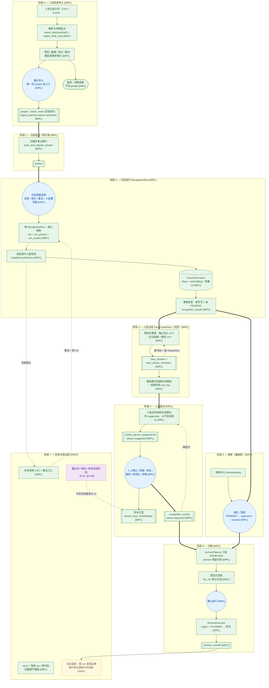

**图上必须看到的三个断点（不是 Stage 3 的新设计，是 Stage 1 已核实的事实）**

| # | 断点 | 后果 | evidence |
|---|---|---|---|
| ① | `person_embeddings` **读活写死**（无生产者） | 识别期 1:N 匹配候选集恒空 → 新写兼容行 `person_id` 恒 NULL → 身份**只能**来自阶段 4 人工确认 | `run_recognition_service.py:66`；`suggest_pairings_service.py:110`（Stage 1 §1-10） |
| ② | 阶段 3/4 与归档之间**没有直接数据边** | 归档只读 `recognition_results.APPROVED`；观测/簇/成员/指派**完全不参与**归档计划 | `archive_planner.py:17-23,116`（Stage 1 §7-1） |
| ③ | APPROVED **双来源不可区分** | 审核通过行与配对投影行字段完全相同（无 source 列），图上只能统一画成一个来源 | `sqlite_recognition_repository.py:31-55` + Stage 2 §7-4 |
| ④ | **无人身 APPROVED ≠ 可归档**（Stage 4 D-1 后语义） | `list_approved_by_person` 要求 `person_id = ?`（`sqlite_recognition_repository.py:266-280`），而①使新写兼容行 `person_id` 恒 NULL。人工补身份有两条路：**审核中心批准时指定人员**（`update_status` 同写 `status + person_id`，同文件 `:298-330`；`review_recognition_service.py:51-71`）或**配对确认三连写**（带 `person_id`）；**未指定身份的批准行仍不进归档计划**（UI 显式告警） | `sqlite_recognition_repository.py:266-280,298-330`；`review_recognition_service.py:51-71`；`archive_planner.py:116` |

---

## 3. 详细业务流程图

### 3.1 名单导入（RO-01/03/04/05）

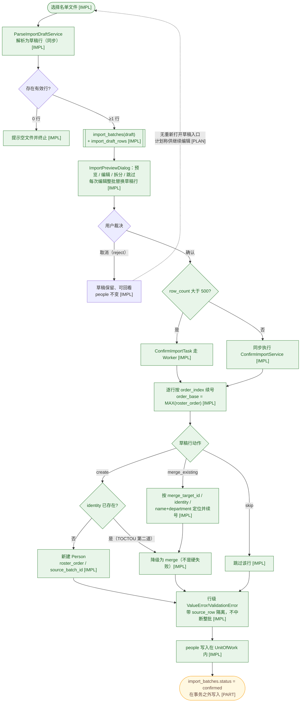

> 事务边界（Stage 1 §7-8）：`people` 在 UoW 内、批次状态 `confirmed` 在 UoW 外（`confirm_import_service.py:90-98`）。
> `import_batches.cancelled` 状态**定义但从未写入**（Stage 1 §7-6 / Stage 2 §6 PLANNED）→ 取消路径上不存在 `cancelled` 节点。
> 重新导入并 merge 会**改写既有人员的 `roster_order` 到新批次位置**（RO-04）→「名单顺序稳定」只能理解为「按最新确认批次的行序」。

### 3.2 识别运行（RE-01~09）：0 脸 / 1 脸 / N 脸 / 不可读 / 检测失败 / 部分成功 / 数量不一致

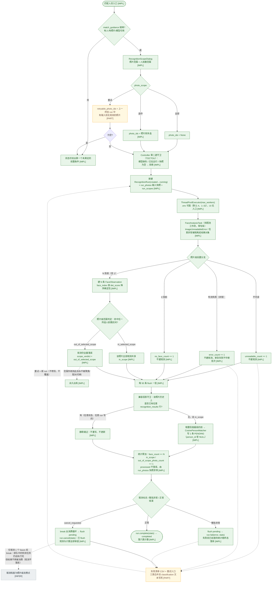

> 补充事实（回查所得）：
> - 统计只有六个计数器 `face_count / unreadable_count / no_face_count / error_count / in_scope_photo_count / out_of_scope_photo_count`；**不存在** `photo_results_counted` 之类的字段，`processed` 由 `run_photos` 快照求得（`recognition_run.py:48-62`）。
> - `RecognitionRunController.start_run()` 已支持 `scope_label`（`recognition_run_controller.py:60-105`），但 `main_window.py:1451-1454` **未传**该参数 → 重试运行参数仍记为 `selected`（Stage 1 §7-4 的问题在 HEAD 依旧存在）。
> - `ThreadPoolExecutor` 的 `max_workers` 来自 `.env`（默认 4，范围 1–32，`settings.py:65-67,113`），**UI 无入口**。
> - 失败清单三分类合并写死（`recognition_failure_service.py:31`）：`run_photos` 不持久化逐照片结果分类，数据上无法区分「未读取 / 检测异常 / 无脸」，只能整体重试（Stage 2 §6-PARTIAL④）。

---

### 3.3 取消 / rerun / 已处理数据（RR-01~05）

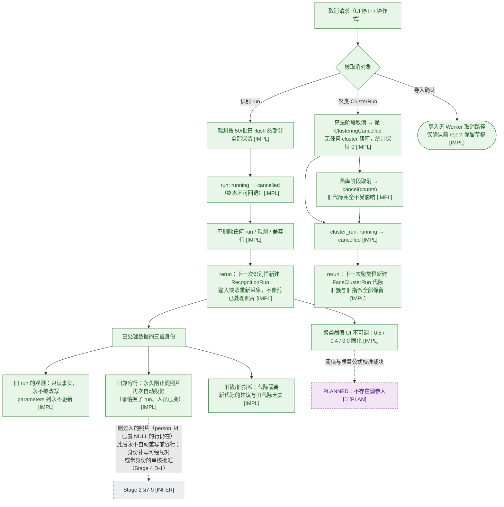

### 3.4 数量不一致（组 vs 人）三分支（PR-11 / Stage 2 §3）

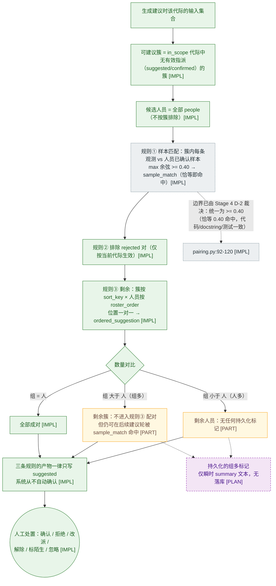

### 3.5 人工修正边界汇总（Stage 2 §4 的人工侧）

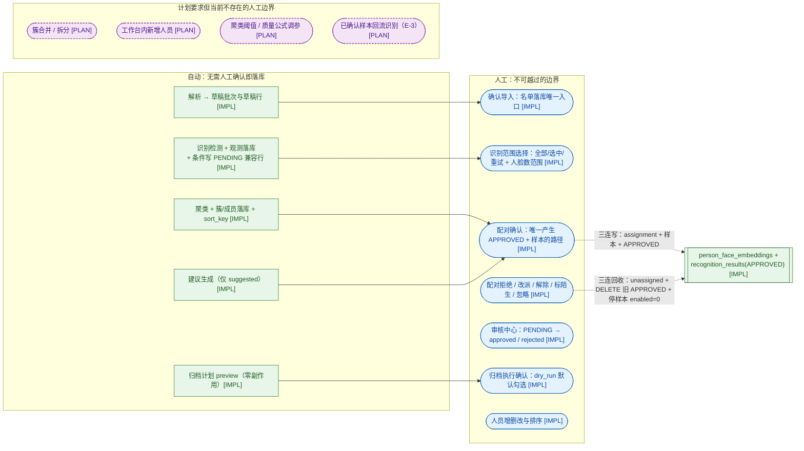

**人工边界的两条必须看到的例外（不是能力，是事实）**

- **删除人员**：`cluster_person_assignments` 与 `person_face_embeddings` 被 **CASCADE 物理删除**（不是转 `unassigned`、不是 `enabled=0`），`recognition_results.person_id` 置 NULL。evidence: Stage 1 §4 / Stage 2 §7-5。
- **unknown / ignored 的簇仍会继续收到新建议**：建议管道只按「有无有效指派」过滤，**不过滤簇状态**（`pairing.py:96-105`）——「忽略」的真实语义无规格背书（Stage 2 §7-2）。
- **审核中心的「通过」只有在指定人员身份时才产生可归档照片**（Stage 4 D-1）：`update_status(result_id, status, person_id)` 可同写身份（`sqlite_recognition_repository.py:298-330`），归档查询要求 `person_id = ?`（`:266-280`）；**未指定身份**的批准（UI 显式告警、默认取消，`review_dialog.py:324-338`）属于"已处理但未确定最终身份"，不进归档计划——把照片变成可归档的人工动作 = 配对确认（Y3）**或带身份的审核批准**（Y5）两条。

---

## 4. Sequence Diagram（只画实际存在的调用关系）

参与者按仓库实际分层：`presentation/views` → `presentation/controllers` → `application/services` → `domain` → `ai`（识别端口）→ `infrastructure/database` → SQLite。

### 4.1 识别运行（最完整的一条链）

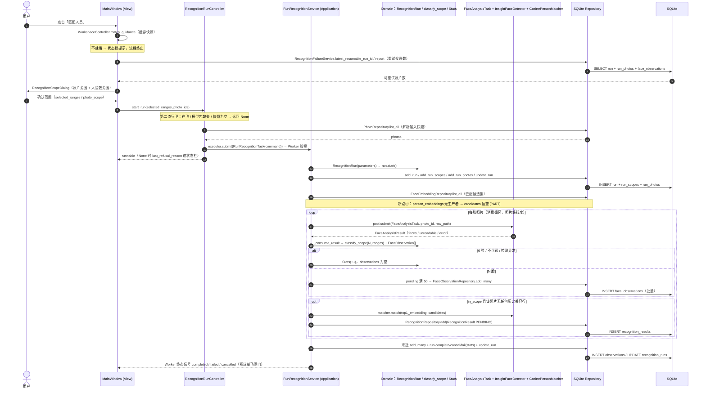

---

### 4.2 聚类 → 建议 → 人工确认（三连写）

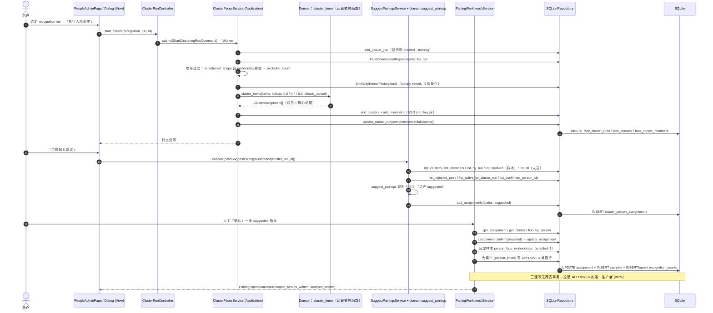

### 4.3 审核 → 归档（历史链，与聚类/配对无关）

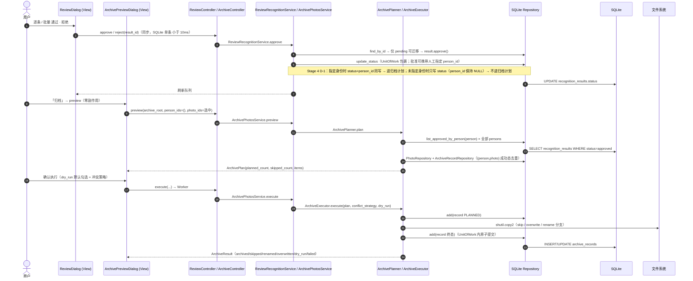

> 三条链的共同事实：**识别链与聚类/配对链只在 `recognition_results` 这一张表上相遇**；`ArchivePlanner` 不查询 `face_observations` / `face_clusters` / `cluster_person_assignments`（`archive_planner.py:17-23,116`）。

---

## 5. 数据生命周期图

### 5.1 核心对象谱系（含旧 `recognition_results` 兼容链的位置）

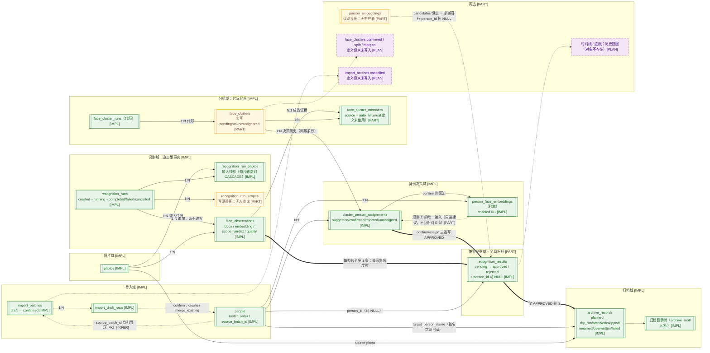

**未实现对象 / 死支的显式清单（对应 Stage 1 §7-6、Stage 2 §6 PLANNED）**

| 对象或字段 | 图上标法 | 事实 |
|---|---|---|
| `person_embeddings` | `[PART]` + 虚线 | 仓储与查询在用，**无任何写入者** → 匹配候选集恒空 |
| `recognition_run_scopes` | `[PART]` | run 创建时写入，**此后无人读取**（范围判定实际来自 `parameters` / command） |
| `face_clusters.confirmed/split/merged` | `[PLAN]` | 枚举已定义，无写入路径 → 不存在簇确认/合并/拆分能力 |
| `import_batches.cancelled` | `[PLAN]` | 枚举已定义，无写入路径 |
| `face_cluster_members.source='manual'` | `[PLAN]` | 常量已定义，只有 `auto` 被写入 → 无手工增删成员能力 |
| 时间线 / 逐照片历史视图对象 | `[PLAN]` | 无表、无服务、无 UI；历史只能按 run 维度人工拼接 |
| `Archive`（归档）对象 | `[IMPL]`＝`archive_records` | 只有记录表 + 文件复制，**无**归档回滚/撤销对象 |

### 5.2 兼容链的位置：谁是事实源，谁是投影

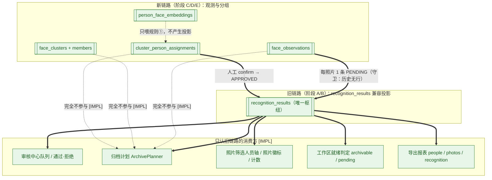

> 结论（Stage 1 §7-1 原话的图示版）：**兼容层是消费侧的事实源，新链路是它的生产者之一**。任何把「观测/簇/指派」直接画成归档输入的图都是事实错误。
> APPROVED 的两个生产者（审核通过、配对确认）在表内**无字段可区分**（Stage 2 §7-4）→ 归档来源只能统一画成 `recognition_results.APPROVED`。
> 但归档还多一个隐藏条件：`list_approved_by_person` 的 SQL 是 `WHERE person_id = ? AND status = ?`（`sqlite_recognition_repository.py:274-279`）。新链路的兼容行 `person_id` 恒 NULL（断点①），而审核中心在 Stage 4 D-1 后可于批准时写入人工指定 `person_id`（同文件 `298-330`）→ **可归档集合 = 「配对确认三连写写出的 APPROVED」∪「审核批准时指定了身份的 APPROVED」**；未指定身份的批准行两者都不是（"已处理但未确定最终身份"）。§8-B12 已按此改写。

---

## 6. 人脸分组 + 人员配对流程图

### 6.1 分组（聚类）内部流程：Observation → Cluster（含时间顺序 sort_key）

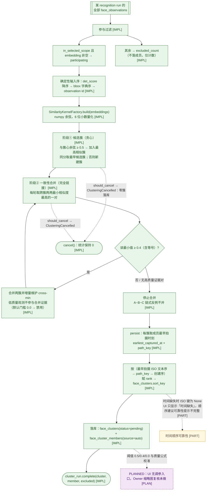

### 6.2 配对：roster_order × sort_key 的自动配对 + 人工调整

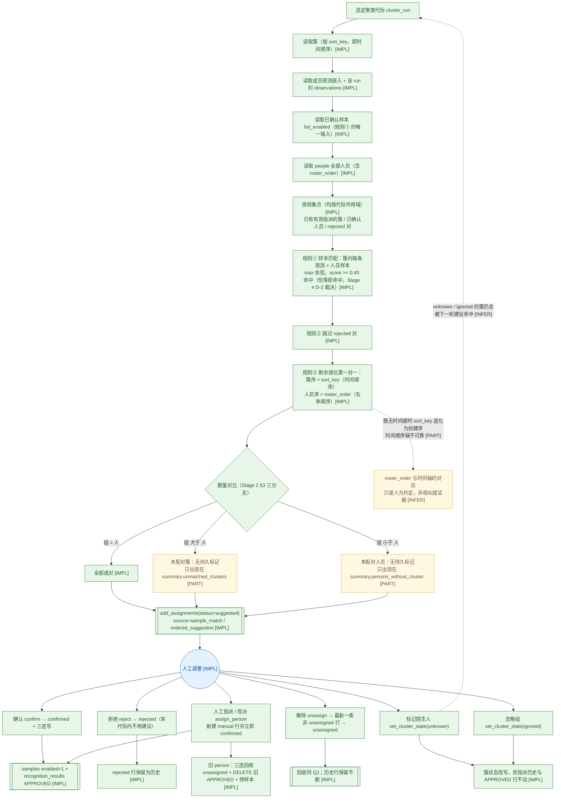

> 空名单事实（必须看到，否则「人多组少」分支会被误读为异常）：`people` 为空时**不产生任何建议**，系统允许「先有组、后建名单」（`pairing.py:17-18` docstring + 可用人员过滤）→ 此时 `unmatched_clusters` 等于全部簇，且**无持久标记**。
> 规则① 的分数边界在 Stage 4 D-2 裁决后**统一为 `>= 0.40`**（`pairing.py:92-120`，阈值判定 `:109-112`：`score < threshold` 直接跳过，`score >= threshold` 才进入候选），恰等于 0.40 命中。模块 docstring 与测试注释已同步为 `>=`（`tests/unit/domain/test_stage_e_pairing_domain.py` 覆盖 <0.40 / ==0.40 / >0.40 三点）。此前的 `[INFER]` 标记与 §9 P-11 的「未裁决」状态同时解除。

### 6.3 `cluster_person_assignments` 决策行状态机（Stage 2 §2 的原文版）

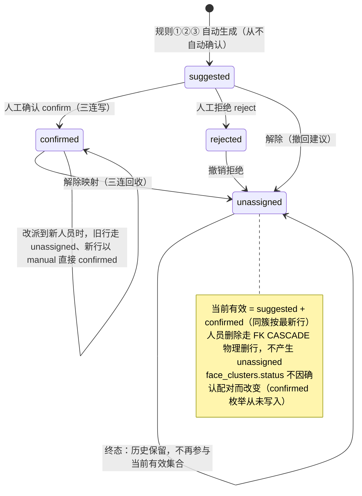

---

## 7. 关键节点说明表

> 「当前代码实现位置」＝本人在 HEAD `2823d1c` 亲自核对的文件:行（2026-09-28 基线收口后重算）；「设计预期含义」＝ Stage 1/2 的规范表述；「差异」列写清是**缺能力**还是**只是未接入**。

| 关键节点 | 业务含义（图上作用） | 当前代码实现位置 | 设计预期含义 | 差异 | 影响主流程 |
|---|---|---|---|---|---|
| 照片集合非空闸门 | 所有 AI/分组操作的统一前置 | `workspace_controller.py:42-64`（`match_guidance`）；就绪计数 `sqlite_recognition_repository.py:181-255`（`read_workspace_counts`） | 工作区就绪即全流程可用 | 就绪判定读旧兼容投影（pending/archivable），与簇/配对无关 | 是：闸门本身生效 |
| `RecognitionRunController.start_run` 第二道闸门 | 单飞 + 模型包 + 快照非空 | `recognition_run_controller.py:60-105` | 同上 | 与 §1 就绪表逐条等价（Stage 2 §6-PARTIAL③） | 是：拒绝即终止 |
| `classify_scope`（域规则） | 每张照片进/出识别范围的唯一判定 | `run_recognition_service.py:105-133` | 范围外的脸不参与分组 | 范围外观测**照样落库**（`scope_verdict=out_of_selected_scope`），出局发生在**读取端**：聚类只取 `in_selected_scope`（`cluster_faces_service.py:108-114`） | 是：出局后永久留存且不参与 |
| `face_observations` 写入 | 每张照片的脸级事实源 | `run_recognition_service.py:85-92`（批量 50） | 观测可反复参与重算 | 追加型，重跑=新 run；聚类才做参与过滤 | 否（但决定重跑成本） |
| 每照片至多 1 条兼容行 | 观测世界 → 兼容世界的唯一窄通道 | `run_recognition_service.py:125-134` | 每张照片一条待审结果 | 多脸照片其余脸**不进审核/归档**（Stage 2 §6-②） | 是：第 2..N 张脸不可归档 |
| 兼容行守卫（历史有行则跳过） | 防止重复待审项 | `run_recognition_service.py:125` | 只跑新增照片 | 新观测无法再进审核 → 跨 run 追加式分组断裂（§8-B1） | **是（最核心分歧）** |
| `APPROVED` 生产者 | 归档唯一输入的产生点 | ① 审核通过 `review_recognition_service.py:51-71,187-191`（**批准可同写人工指定 `person_id`——Stage 4 D-1；未指定时只写 status**）；② 配对确认三连写 `pairing_workbench_service.py:276-345` | 人工确认身份 | 两来源同表同质、**无字段可区分来源**；未指定身份的批准行 `person_id` 保持 NULL → 仍不可归档 | 是 |
| 聚类两段式 + 阈值 | 组（Group）的生成 | `cluster_faces_service.py:40-45`，`domain/services/face_clustering.py` | 阈值可按真实样本校准 | 0.5/0.4/0.0 写死，UI 无调参入口 | 是（决定分组质量上限） |
| `sort_key`（时间顺序轴） | 「组按时间顺序」的唯一实现 | `cluster_faces_service.py:218-237`（成员最早拍摄时刻 → ISO 文本序） | 分组按时间排序供逐时点核对 | 时间缺失时可靠性提示不完整（Stage 1 §2 阶段 D-3） | 否（但影响人工核对效率） |
| `roster_order` → 建议序 | 「导入名单顺序 ↔ 组时间顺序」假设 | `suggest_pairings_service.py:115-119`（roster_order 进入建议输入）+ `domain/services/pairing.py:82-86`（排序）规则③ | 位置对应只给建议，人必须核对 | 假设本身无规格背书（Stage 2 §7-3） | 否（人可改正） |
| `cluster_person_assignments` 决策行 | 人工调整全历史 + 当前有效集合 | `sqlite_cluster_assignment_repository.py:92-117`（`update_assignment` 改写 `status`/`score`/`sort_snapshot`/`confirmed_at`） | 改派/解除保留历史 | **行内改写状态列、不删历史行**；人员删除才 CASCADE | 是（决定「当前有效」口径） |
| 三连写 / 三连回收 | 人工确认 ↔ 兼容世界的一致性桥 | `pairing_workbench_service.py:105-137`（confirm）、`:276-345`（`_sink_confirmation`）、`:185-229`（assign_person）、`:347-374`（`_retract_confirmation`） | 确认即归档就绪 | 无跨表事务（Stage 2 §6-PARTIAL①） | 是（中途失败留幽灵状态） |
| `ArchivePlanner.plan` 只读 APPROVED | 归档范围定义 | `archive_planner.py:104-151`（plan）、`:116`（唯一数据入口） | 归档应基于确认后的组/身份 | 完全不读观测/簇/指派 | **是（第二处分歧）** |
| `import_batches.status` 在事务外更新 | 导入批次标签落库 | `confirm_import_service.py:90-98`（UoW 内只写 people，`:96-98` 事务外 `set_batch_status`） | 批次与名单同事务 | 提交后额外写库，非原子（Stage 2 §6-PARTIAL①） | 否（小概率标签不一致） |
| `person_embeddings`（读取侧） | 「与已确认人员比对」的设计入口 | `run_recognition_service.py:66`（读）/ 无写入方 | 人员身份自动匹配 | **无生产者**；被 `person_face_embeddings` 事实替代 | 是：新照片从不自动带 person_id |
| `person_face_embeddings.enabled` | 样本可撤回（Stage 2 §7-7） | 写入 `confirm/assign` 路径；撤回入口未暴露 | 人员样本可停用/替换 | 字段存在但 UI 无撤回入口 | 否（前瞻能力缺口） |
| 归档去重身份（Stage 4 BLK-1 修复） | 「同一照片可归档到多个人员目录」的真实去重键 | `archive_records.person_id`（`alembic/versions/008_...py`）+ `sqlite_archive_record_repository.py:107-138`（`has_successful_for_person`） | Stage 1 §1-3 段 7 / Stage 2 CORE-06 记为 `(person_id, photo_id)` | **按稳定 person_id 去重**（旧实现按 `target_person_name` 字符串）；`person_id IS NULL` 的存量行回退姓名匹配；同名不同人互不抑制，改名后不重复归档；workspace counter 同口径（`sqlite_recognition_repository.py:219-241`）。**已知限制（Stage 4.1 KL-1/KL-2）**：存量重名归档行与人员删除后 SET NULL 的孤儿行仍按姓名回退——"删人 + 同名重建"可能被静默抑制 | 是（修复前会导致照片静默漏归档/重复归档） |
| 兼容行 confidence 三态（Stage 4 BLK-5 修复） | 「无相似度证据」≠「相似度为零」 | `RecognitionResult.confidence: float | None`（`domain/entities/recognition.py:47`，三态语义 docstring `:34-38`）；配对确认写 NULL 见 `pairing_workbench_service.py:321-323` | 旧实现把位置配对（无 score）写成 `0.0` | `NULL` = 无相似度证据（位置配对/人工指派）；数值 = 样本匹配真实余弦 | 否（但消除"已归档记录置信度为 0"的困惑数据） |
| 审核批准携带身份（Stage 4 D-1 修复） | 「人工最终结果」与归档链路一致 | `update_status(result_id, status, person_id)`（`sqlite_recognition_repository.py:298-330`）；UI 选择器 `review_dialog.py`（`_identity_combo`） | Stage 2 §4 把「审核通过」列为人工边界，但未定义身份来源 | 审核可**指定人员**后批准，身份与状态同写入；未指定时显式告警（不静默产出不可归档行） | 是（修复前批准结果永远进不了归档） |

---

## 8. 实现 vs 设计预期：事实差异对照表

> 三类信息分列：**实现事实**（代码可指认）、**设计预期**（Stage 1/2 规范）、**业务图应表现方式**（本项目所有图的统一处置口径）。

### 8-A 主流程一致（无需特殊画法，只标 `[IMPL]`）

| # | 主题 | 实现事实（代码证据） | 设计预期 | 业务图应表现方式 |
|---|---|---|---|---|
| A1 | 导入名单 → 人员档案 | `confirm_import_service.py:50-109`：create / merge_existing 分流、单 UoW 写 people；`:96-98` 批次状态在事务外翻转 | Stage 1 阶段 D-1、Stage 2 §5 规则 3/4 | 正常实线 + `[IMPL]`；「只登记不建号」独立终止框 |
| A2 | 范围闸门 0..5 段 | `run_recognition_service.py:104-133`；`pairing_workbench_service.py:248-266`（`_require_assignment/_require_cluster/_require_person` 同型校验族） | Stage 1 §2 阶段 C / Stage 2 §2 | 终止框（`in_scope=0`）+ 出局注记 |
| A3 | 单飞闸门与拒绝原因 | `recognition_run_controller.py:60-109`、`cluster_faces_controller.py` | Stage 2 §4 第 1 条 + §6-PARTIAL③ | 双闸门串列（View 闸门 + Controller 闸门） |
| A4 | 聚类两段式 0.5 / 0.4（含等号） | `cluster_faces_service.py:40-45` + `domain/services/face_clustering.py` | Stage 1 阶段 D-3、Stage 2 §2 | 循环回边 + 「A~B~C 不并」注记 |
| A5 | 建议只产 suggested，从不自动确认 | `domain/services/pairing.py` + `pairing_workbench_service.py`（同步、无 Worker） | Stage 2 §2、§7-3 | 蓝色「人工闸门」节点，任何 confirm 弧必须穿过它 |
| A6 | 重跑 = 新 run，不修剪不覆盖 | `run_recognition_service.py:46-60`（新建 run + 输入快照） | Stage 1 阶段 C、§6-2 | 失败清单回边写成「新 run」 |
| A7 | 取消语义（保留已 flush 数据 + 计数） | `run_recognition_service.py:91-93`、`cluster_faces_service.py:98-99,163-169`、`archive_executor.py:119-125` | Stage 1 阶段 C、§6-2 | 终态三分支各自标注保留内容 |
| A8 | 归档幂等 + dry-run 不留下次依据 + 冲突三策略 | `archive_planner.py:89-100`、`archive_executor.py:40,52-101,134-146`、`archive_preview_dialog.py:111-118` | Stage 1 阶段 B/E、Stage 2 §2 | 执行链入口画 dry_run 分叉；dry_run 用虚线连回预览 |

---

### 8-B 主流程不一致（**必须在图上可见**，本项目采用「双轨画法」）

| # | 主题 | 实现事实（代码证据） | 设计预期（Stage 1/2 原话） | 业务图应表现方式 |
|---|---|---|---|---|
| **B1** | 兼容行一次性 | `run_recognition_service.py:125`：该照片已有任何 `recognition_results` 行 → 本次新观测不再产生待审项；`archive_planner.py:17-23,116` 只读 APPROVED | Stage 1 §7-1：「兼容层是消费侧事实源，新链路是生产者之一」；Stage 2 §6-①：「归档只认旧表 approved → 只走新链路的照片进不了归档」；Stage 1 §6-2「重跑 = 新 run、**新分组**」隐含旧待审项应可被新观测替换 | **双轨画法**：`face_observations → recognition_results` 弧上标注守卫条件与「每照片至多 1 条」；另起虚线弧写「新观测 → 审核/归档：当前无通路 `[PART]`」；**不把簇/指派直连归档** |
| **B2** | 身份事实源二义 | 匹配读 `person_embeddings`（`run_recognition_service.py:66`，**无生产者**）；建议读 `person_face_embeddings`（`suggest_pairings_service.py:110`，只进建议；样本沉淀写入见 `pairing_workbench_service.py:297-312`） | Stage 1 §6-4 / Stage 2 §6-③：「与已确认人员比对必须走人工确认，未确认不自动归档」 | 两个候选集分别画源表并标 `[PART]`；「candidates 恒空 → person_id 恒 NULL」显式成框；**禁止**画「自动身份确认」 |
| **B3** | 多脸只投影一次 | `run_recognition_service.py:110-134`：取最高置信度脸 1 条投影 | Stage 1 §6-3：「部分人脸已确认、部分待审 → 只归档已确认部分（人工确认边界）」；Stage 2 §6-②：「一张照片多个组」只投影一次 | Observation 侧画 `1..N` 扇出，兼容侧强制收束为 `1`，并把「第 2..N 张脸不可审核 / 不可归档」写成 `[PART]` 终止框 |
| B4 | 簇状态未参与建议过滤 | `pairing.py:96-105` 只按「有无有效指派」过滤，不判簇状态 → unknown / ignored 簇继续收建议 | Stage 1 §6-6 / Stage 2 §6-⑤：「陌生人（或无身份照片）单独一组，不得混入任何人员」 | 「陌生人 / 忽略组」框 + 虚线回边到下一轮建议并标 `[INFER]`；同时在 §9 登记为语义缺口 |
| B5 | 批次标签在事务外写 | `confirm_import_service.py:90-98`：people 写入在 UoW 内，`:96-98` 的 `set_batch_status(confirmed)` 在事务外 | Stage 2 §5 规则 3「同事务提交」 | 用「提交后额外写库（非原子）」注释框，不画进事务边界 |
| B6 | 三连写无跨表事务 | `pairing_workbench_service.py:105-137`（confirm）、`:276-345`（_sink_confirmation）、`:185-229`（assign_person） | Stage 2 §6-PARTIAL① | 三连写画成单一显式节点，旁注「无跨表事务 → 半完成风险 `[PART]`」 |
| B7 | 照片删除的跨代际残留 | `pairing_workbench_service.py:347-374`（`_retract_confirmation`）只按当前簇的成员照片回收；`archive_records`/`recognition_results` 的 `photo_id` FK 为 ON DELETE CASCADE（`002:92,119`） | Stage 2 §6-PARTIAL② | 生命周期图上把 CASCADE 弧与「已确认指派仍在、但 APPROVED 行被 CASCADE 抹掉」的注记并列 |
| B8 | 历史视图不存在 | 无表 / 无服务 / 无 UI | Stage 1 §6-5：「按时间顺序逐时点核对调整是否合理」 | 主流程图中该环节画成 `[PLAN]` 虚框（不参与事实流），不画成能力 |
| B9 | 导入只登记不建号 / 批次不可取消 | 导入确认不建号；`import_batches.cancelled` 枚举从未写入 | Stage 2 §6-⑦「导入名单只登记不建号」；Stage 2 §4 允许把批次置「取消」 | 独立终止框 + `[IMPL]`「只登记不建号」；`cancelled` 标 `[PLAN]` |
| B10 | 失败分类不可分 | `recognition_failure_service.py:31` 三类合并写死；`run_photos` 不存逐照片分类 | Stage 1 §6-1 要求区分「读不到 / 检不出 / 不纳入」 | 图上用单个「失败清单（三类合并）」节点 + `[PART]`，不画三分支导出通道 |
| B11 | 取消时排队任务仍执行 | `run_recognition_service.py:71-79`：仅取消 1 个 future 后 break，`with` 退出等待其余已提交任务 | Stage 1 §6-2「停止后已处理数据保留」 | 取消分支标注「粒度＝照片级消费点；已提交检测仍跑完但结果丢弃 `[INFER]`」 |
| B12 | **无人身 APPROVED ≠ 可归档（Stage 4 D-1 改写）** | `update_status(result_id, status, person_id)` 在批准时可同写人工指定身份（`sqlite_recognition_repository.py:298-330`）；未指定身份时只写 `status`，该行 `person_id` 保持 NULL，而归档查询要求 `person_id = ?`（同文件 `266-280`）→ **未指定身份的批准行不进归档计划**（UI 显式告警、默认取消）；指定身份的批准行与配对确认投影行同等可归档 | Stage 2 §4 把「审核通过」列为人工边界；D-1 裁决：**用户人工选择、修改或确认的人员身份即为最终业务结果**（`Approve + person_id = NULL` → 已处理但未确定最终身份，不进入按人员归档计划，UI 明确提示）；自动识别兼容行仍可能 `person_id IS NULL`（自动识别未建立最终身份） | 图上必须区分「APPROVED（无人身，已处理但未确定身份）」与「APPROVED（带 person_id，可归档）」两种状态；归档入口只连后者 |

---

## 9. PLANNED / PARTIAL 清单（**不得画成当前能力**）

> 判定口径（Stage 2 §6 原文 + 代码回查）：
> · **`[IMPL]`** ＝ 代码可指认的执行路径；
> · **`[PART]`** ＝ 代码在跑，但语义不完整、或与设计不一致（现状事实，不是缺口）；
> · **`[PLAN]`** ＝ 设计有、代码没有（枚举已定义但无写入路径、或完全无实现）；
> · **`[INFER]`** ＝ 由代码逻辑推得、文档未明写；**`[UNK]`** ＝ 需 Owner 答复。

| 编号 | 能力（设计预期） | 当前事实（可指认证据） | 标签 | 图上处置 |
|---|---|---|---|---|
| P-01 | 与已确认人员自动比对产生身份 | 读 `person_embeddings`（`run_recognition_service.py:66`），**该表无任何写入方**（Stage 1 §7-3） | `[PART]` | 画成空候选集 + 「person_id 恒 NULL」终止框；**禁止**画自动身份确认弧 |
| P-02 | 归档计划以确认后的簇/身份为依据 | `archive_planner.py:17-23,116` 只读 `recognition_results(APPROVED)` | `[PART]` | 双轨画法；新链路→归档的缺口单独画虚线弧 |
| P-03 | 簇级确认态（`confirmed`）与合并/拆分 | 枚举定义存在，写入路径不存在（Stage 2 §6-PARTIAL⑤） | `[PLAN]` | 虚框 + 「当前仅 pending/unknown/ignored 实写」 |
| P-04 | 手工把脸移入/移出组（成员级调整） | 只有「整组改派」（簇级），`face_cluster_members.source='manual'` 无写入 | `[PLAN]` | 虚框；当前能力只画「未匹配簇人工指派 / 改派」 |
| P-05 | 导入批次可取消（`cancelled`） | 枚举定义存在，写入路径不存在（Stage 2 §6-PARTIAL⑥） | `[PLAN]` | 生命周期图虚线终态，实线弧禁止 |
| P-06 | 逐照片调整历史视图（按时间逐时点核对） | 无表 / 无服务 / 无 UI；仅能按 run 维度人工拼接 | `[PLAN]` | 历史视图环节画 `[PLAN]` 虚框 |
| P-07 | 聚类阈值按真实样本校准 + Owner 缩略图复核 | 0.5 / 0.4 / 0.0 与质量公式写死，UI 无入口（Stage 1 验收表、Stage 2 §6 PLANNED） | `[PLAN]` | 虚框 + 注记「参数在代码/配置，不在 UI」 |
| P-08 | 人员样本撤回 / 替换（`enabled=0` 的入口） | 列存在且 confirm 写 `enabled=1`，无撤回入口 | `[PLAN]` | 虚框；实线只画「沉淀样本」 |
| P-09 | 范围外人脸「落库但不参与」（Stage 2 §2 措辞） | **与代码一致**：`run_recognition_service.py:118-123` 对 N 脸照片无条件建观测（含 `scope_verdict=out_of_selected_scope`），出局发生在**读取端**——聚类只取 `in_selected_scope` 且嵌入有效者，其余计入 `excluded_count`（`cluster_faces_service.py:108-114`） | `[IMPL]`（Stage 3 校正：本文早期草稿曾误记为「不落库」） | 图上写「范围外＝落库但被读取端过滤」；补充事实：这些观测**永久留存且无清理入口** |
| P-10 | 一键批量确认建议 | 无批量确认；逐条人工确认（Stage 2 §6-PARTIAL⑦） | `[PLAN]` | 人工闸门必须是单条粒度；不画批量确认弧 |
| P-11 | 「忽略组」与「陌生人」的规格语义 | `set_cluster_state(ignored)` 可执行，但 ignored 簇下一轮仍会收建议（`pairing.py:96-105`）；规格无背书（Stage 2 §7-2） | `[UNK]` | 图上标 `[UNK]`，并列入 §10 待决问题 |
| P-12 | 重试运行记录真实 `photo_scope` 标签 | `scope_label` 已支持但 `main_window.py:1451-1454` 未传 → 记为 `selected`（Stage 1 §7-4） | `[PART]` | 运行参数框加注记 |
| P-13 | 取消后立即停止全部已提交 AI 计算 | 取消粒度＝照片级消费点；已提交任务仍执行完再丢弃 | `[PART]` | 取消分支注记（`[INFER]`） |
| P-14 | 失败清单区分「未读取 / 检测异常 / 无脸」 | 三类合并写死（`recognition_failure_service.py:31`），数据层无分类列 | `[PART]` | 单个失败清单节点 + `[PART]` |
| P-15 | `run_scopes` 参与范围判定 | 写活读死：无人读取该表（Stage 1 §7-5） | `[PART]` | 画成「审计记录」而非判定输入 |

**硬约束复述（Stage 2 §6 PLANNED 三句）**：① 自动建议**永远不等于自动确认**；② 「导入顺序 ↔ 时间顺序」只是人为约定，**不得画成相似度证据**；③ 人工确认只保证**照片级**可归档，**不覆盖人脸级边界**。

---

## 10. 交付自检与评审待决问题

### 10.1 对照六项要求的自检

| 要求 | 落点 | 自检结果 |
|---|---|---|
| 1. 整体业务流程图（含导入名单 / 范围闸门） | §2（主干）+ §3.1 / §3.2 | 主流程、全部终止节点、全部异常分支均可见；0 脸 / 不可读 / 检测异常 / 范围外四类逐条成框 |
| 2. Sequence Diagram（只画实际调用关系） | §4.1 / §4.2 / §4.3 | 参与者＝真实分层；无虚构调用；Worker 线程、批量 flush、CASCADE、三连写均按代码标注 |
| 3. 数据生命周期图（含旧兼容链位置） | §5.1（谱系）+ §5.2（兼容链） | 七类核心对象 + 旧兼容链枢纽位置 + 死支清单（§5.1 表） |
| 4. 人脸分组 + 人员配对流程图 | §6.1（分组 + sort_key）+ §6.2（roster_order × 人工调整）+ §6.3（状态机） | 含时间顺序、数量不一致、未配对、人工调整四类 |
| 5. 关键节点说明表 | §7 | 15 个关键节点，四列齐备（含「是否影响主流程」） |
| 6. 实现 vs 设计预期事实差异对照表 | §8（A/B 两表） | 一致 8 项（A1–A8）+ 不一致 12 项（B1–B12），每项给「图上应表现方式」 |
| 未实现对象必须标记 | §9（P-01~P-15）+ 各图 `[PLAN]` 虚框 | 所有 PLANNED 均为虚线框，无一条被画成当前能力 |

**Stage 1 §6 七条人工确认边界** → 全部在 §3.5 成图；**Stage 1 §7 六个事实偏差** → 全部在 §7/§8-B/§9 落地；**Stage 2 §6 六条不一致 + PARTIAL①~⑦ + PLANNED** → 全部在 §8-B/§9 落地。

### 10.2 建议以这三条为主线开评审会（图上已可见）

1. **兼容层收敛策略**（§8-B1/B2/B12 + §2 断点④）：归档与筛选长期只认 `recognition_results.APPROVED`，该表的写入方是「旧链审核」+「新链配对」两者。**Stage 4 D-1 已落地**：审核中心批准时可写入人工指定 `person_id`（未指定时 UI 显式告警）——「让审核中心具备写 `person_id` 的能力」这一待决已关闭；**未指定身份的批准行仍不进归档计划**。剩余待决：兼容层是否转成**视图**（消费侧改读新链）、是否补 `person_embeddings` 生产者（E-3）、是否加来源标记列区分两来源（§10.3 Q2）。
2. **多脸照片的归档粒度**（§8-B3、Stage 1 §6-3）：当前投影「每照片 1 条」→「只归档已确认部分」这条边界在实现上无法表达（照片要么进归档要么不进）。
3. **建议 ≠ 确认 的可核对性**（Stage 2 PLANNED + P-06/P-07）：`confirmed` 态、逐照片历史视图、阈值校准三者都缺 → Owner 无法「按时间顺序逐时点核对建议是否靠谱」。

### 10.3 需要 Owner 答复的 `[UNK]`（沿用 Stage 2 §7，本文补充）

| 编号 | 问题 | 图上已画出的证据位置 |
|---|---|---|
| Q1（=Stage 2 §7-2） | 「忽略组」是否要求跨代际持久、是否应停止后续建议 | §3.5 Z2/Z5 + §9 P-11 |
| Q2（=Stage 2 §7-4） | `recognition_results` 是否需要新增列区分「审核确认」与「配对确认」 | §5.2 生产者注记 |
| Q3（=Stage 2 §7-6） | 「陌生人」是否要求 ≥2 张照片支撑 | §3.5 Z4 |
| Q4（本文新增） | 取消时是否需要真正停止已提交的 AI 计算（当前仅照片级消费点停止） | §3.2 Z2 + §9 P-13 |
| Q5（本文新增） | `person_embeddings` 保留还是删除（当前为只读死表，误导「人员向量已就位」） | §2 F1 / §5.1 PEMB |

### 10.4 与 Stage 2 措辞的两处复核结论（1 处撤回本文早期误记 / 1 处补充实现细节）

1. **撤回本文早期草稿的一处误记**：我曾把「范围外人脸」记成**不落库**，回查 `_consume_result`（`run_recognition_service.py:111-133`）后确认：**N 脸照片无条件建 N 条观测**（`scope_verdict` 随 `classify_scope` 结果），出局发生在**读取端**——聚类只取 `in_selected_scope` 且嵌入有效者（`cluster_faces_service.py:108-114`）。**Stage 2 §2 的措辞是正确的，无需校正**；本文 §3.2 / §6.1 / §7 已按此画法统一。真正的缺口是这些观测**永久留存、无清理与查看入口**（§9 P-09）。
2. Stage 2 §3 数据流图写「recognition_results ← observation + matching」——实现附带**一次性守卫**（该照片已有任意兼容行即跳过，`run_recognition_service.py:125`）。本文按带守卫画法。

### 10.5 图的校验方式

全部 mermaid 代码块均通过两级机器校验（mermaid 12.10.2，jsdom + `--legacy-peer-deps` 环境）：

1. **语法级**：`mermaid.parse()` 逐块解析 ＝ **14 块全部 PASS**（flowchart 10 / sequence 3 / stateDiagram-v2 1）。
2. **渲染级**：`mermaid.render()` 逐块出图（对 jsdom 缺失的 SVG 度量 API 打桩）＝ **14 块全部产出 SVG，0 失败**，用于捕获 `class`/`classDef` 引用不存在节点、subgraph 与跨子图连线等 parse 阶段不报错的问题。
3. **Markdown 结构**：代码围栏配对 14/14、表格各列数一致（0 处告警）。标签一律写在**引号内的节点文本**里（节点写作 `A["文本 [IMPL]"]`），不使用 class 名或富文本承载事实标签，确保在只支持纯 Mermaid 的渲染器（GitHub / VS Code / Typora）中一致显示。

标签统计（全文出现次数，含本行自身）：`[IMPL]` 170 · `[PART]` 39 · `[PLAN]` 30 · `[INFER]` 15 · `[UNK]` 6。

---

*文档结束。所有事实标签与 Stage 1 §7、Stage 2 §6/§7 逐条对应；代码回查基于 HEAD `2823d1c`（`main`，2026-09-28 基线收口）。*

